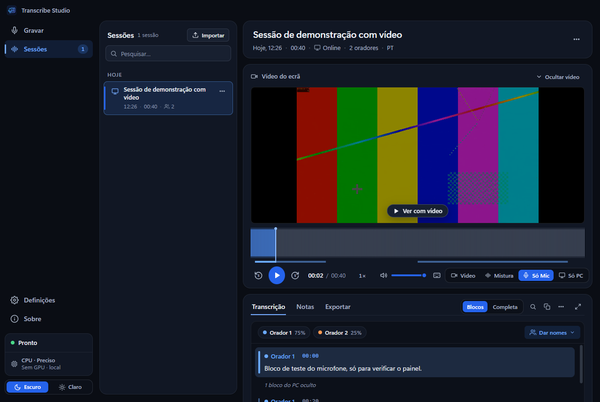
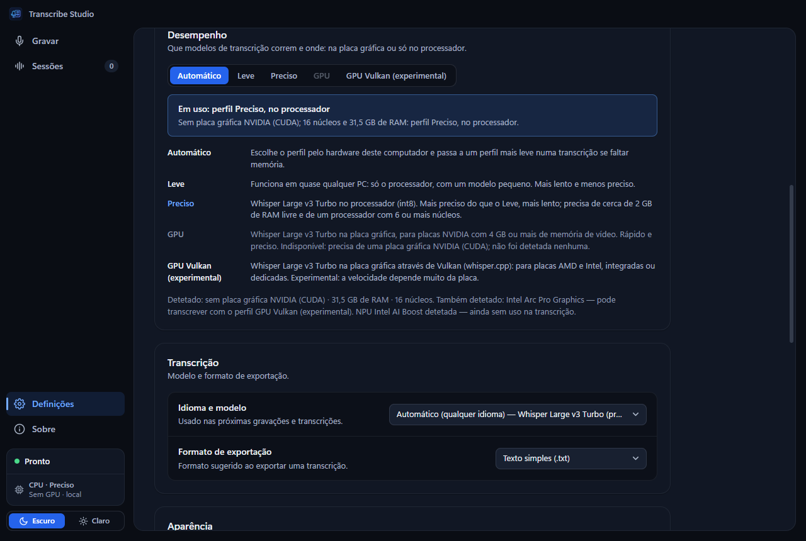
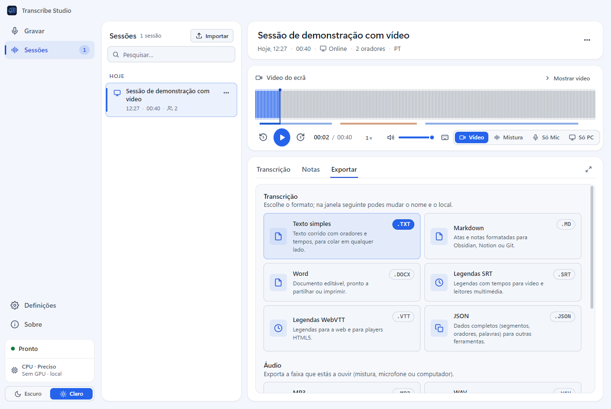

# Transcribe Studio

Estúdio local para Windows que grava reuniões (microfone e som do PC em simultâneo), as transcreve neste
computador e deixa rever, editar e exportar o resultado. O áudio e as transcrições nunca saem da máquina.

Este repositório tem os instaladores e as notas de cada versão. A aplicação instalada procura aqui as
versões novas.

**[Descarregar a versão mais recente](../../releases/latest)**

## O que faz

- **Grava** o microfone e o som do PC ao mesmo tempo, em faixas separadas, e opcionalmente o ecrã ou uma
  janela em vídeo. Gravações interrompidas são recuperadas no arranque seguinte.
- **Transcreve localmente** com o Whisper Large v3 Turbo, na placa gráfica ou no processador, com deteção
  de voz e separação de oradores. O idioma é detetado em cada trecho ou forçado (português, inglês,
  espanhol, francês, alemão, italiano).
- **Revê e edita**: leitor com forma de onda e vídeo, transcrição que acompanha a reprodução, edição de
  blocos e de oradores, notas por sessão, e as faixas do microfone e do PC ouvidas em separado.
- **Exporta** a transcrição em texto, Markdown, Word, legendas SRT e WebVTT ou JSON, o áudio em MP3 ou
  WAV e o vídeo em MP4.
- **Importa** ficheiros de áudio e de vídeo para transcrever.

## Perfis de desempenho

A aplicação escolhe o perfil pelo hardware do PC; pode ser mudado em Definições → Desempenho.

| Perfil | Onde corre |
|---|---|
| GPU | Placa NVIDIA com 4 GB ou mais de memória de vídeo (CUDA) |
| Preciso | Só o processador, com o mesmo modelo do perfil GPU (6 ou mais núcleos, 8 GB de RAM) |
| Leve | Só o processador, com um modelo pequeno; funciona em quase qualquer PC |
| GPU Vulkan (experimental) | Placas AMD e Intel, integradas ou dedicadas, através de Vulkan; tem de ser escolhido à mão |

## Instalar

1. Descarrega `Transcribe-Studio-Setup-<versão>.exe` da página de [versões](../../releases) e executa-o. A
   instalação é só para o teu utilizador e não pede permissões de administrador.
2. O instalador não tem assinatura digital, por isso o Windows pode mostrar "O Windows protegeu o seu PC":
   escolhe **Mais informações** → **Executar mesmo assim**. Com o Controlo Inteligente de Aplicações
   (Smart App Control) do Windows 11 ligado, o Windows pode bloqueá-lo sem dar essa opção.
3. Na primeira utilização, a aplicação transfere e instala os componentes de transcrição e o modelo de voz:
   cerca de 2,7 GB com placa NVIDIA, ou cerca de 373 MB só para o processador, mais o modelo (até 1,7 GB).
   Precisa de internet só nesta fase.

Cada versão traz o SHA256 do instalador nas notas, para confirmares o ficheiro.

### Requisitos

- Windows 10 ou 11, 64 bits (testado no Windows 11).
- Para o perfil GPU: placa NVIDIA com 4 GB ou mais de memória de vídeo e um controlador com suporte para
  CUDA 12.4 (versão 551.61 ou posterior).
- Espaço em disco: cerca de 5,5 GB com placa NVIDIA, cerca de 1,9 GB só para o processador, mais os modelos.

### Atualizações

A partir da versão 2.0.0, a aplicação procura versões novas ao arrancar, transfere-as em segundo plano e
instala-as quando reiniciares (Sobre → Atualizações) ou da próxima vez que a fechares. Só pede a este
repositório o ficheiro de versão e o instalador: nada sobre ti nem sobre as gravações é enviado.

## Privacidade

A gravação, a transcrição e a separação de oradores correm no teu computador. A aplicação só usa a
internet para transferir os componentes e os modelos na instalação e para procurar atualizações.

## Licença

Transcribe Studio é distribuído sob a licença MIT (ver [LICENSE](LICENSE)). O instalador e os componentes
que transfere incluem software de outros projetos, listados em
[THIRD-PARTY-NOTICES.md](THIRD-PARTY-NOTICES.md) com as respetivas licenças.

As capturas de ecrã mostram sessões de demonstração criadas com áudio e vídeo sintéticos.
